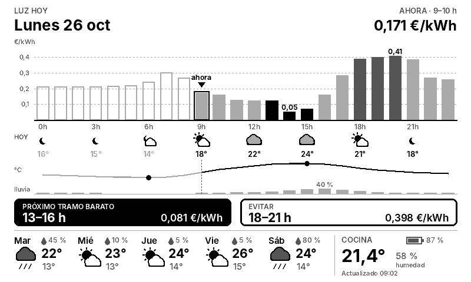
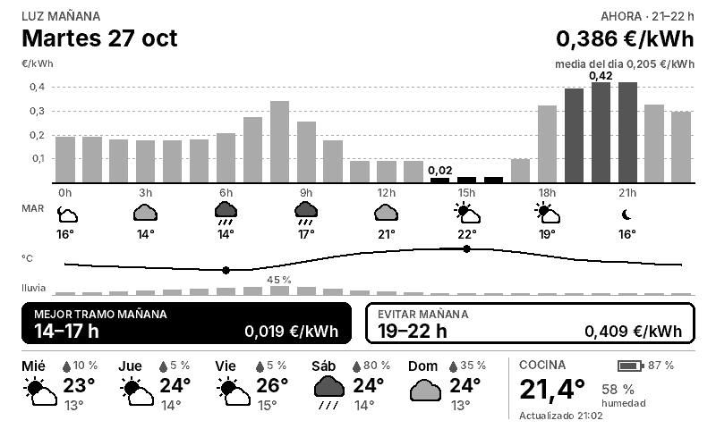

# Pantalla del frigo (ePaper)

Imagen para una pantalla de tinta electrónica **Seeed reTerminal E1001** (7,5", 800×480, 4 grises): muestra el precio de la luz (tarifa regulada PVPC 2.0TD, Península), el tiempo de hoy hora a hora y el de los próximos días en Alquerías (Murcia).

| De 7 a 20 h: precios de hoy | En cuanto se publican los de mañana (hacia las 20:15) |
| --- | --- |
|  |  |

*Ejemplos con datos de muestra. El recuadro de abajo a la derecha (cocina, batería y hora) lo dibuja la propia pantalla.*

## Cómo funciona

```
GitHub Actions (cada hora + espera por la tarde)
   │  descarga los precios (Red Eléctrica) y el tiempo (Open-Meteo)
   │  genera pantalla.png, pantalla.bin y estado.json
   ▼
GitHub Pages  ──►  la pantalla se despierta, consulta estado.json,
                   y si la versión ha cambiado descarga pantalla.bin y la dibuja
```

- **Cada hora** (minuto 2): genera la imagen. Durante el día, la hora actual va marcada con "ahora".
- **Por la tarde**: a partir de las 19:40, una ejecución consulta Red Eléctrica cada 2 minutos hasta que se publican los precios de mañana (normalmente hacia las 20:15). Entonces publica la imagen de mañana y termina.
- **Fuentes de precios**, por orden: API pública REData de Red Eléctrica (sin token), fichero público diario de ESIOS y API ESIOS con token (solo si se crea el secreto `ESIOS_TOKEN`).
- **Tiempo**: Open-Meteo, gratis y sin registro.

## Archivos publicados

| Archivo | Para qué |
| --- | --- |
| `pantalla.png` | La imagen, para verla en el móvil o el PC (`index.html` la muestra y se refresca sola) |
| `pantalla.bin` | La misma imagen para la pantalla: 96.000 bytes, 2 bits por píxel, 4 píxeles por byte (bits altos primero); 0 = negro, 1 = gris oscuro, 2 = gris claro, 3 = blanco |
| `estado.json` | `version` (cambia cuando cambia la imagen), `modo` (`hoy`/`manana`), hora de generación y coordenadas del recuadro que dibuja la pantalla |

## Puesta en marcha

1. En el repositorio: **Settings → Pages → Build and deployment → Source: GitHub Actions**.
2. **Actions → Actualizar pantalla → Run workflow**, para la primera ejecución.
3. La imagen queda en `https://<usuario>.github.io/<repositorio>/`.

## Probar en el PC

```bash
pip install -r requirements.txt
python generador/main.py --salida salida            # con datos reales
python generador/render.py --ejemplo prueba.png hoy 9   # vista previa con datos de muestra
python -m unittest discover tests                    # pruebas sin conexión
```

## Pendiente

- Firmware de la pantalla (ver `firmware/README.md`), cuando llegue el aparato.

Fuente tipográfica: [Inter](https://github.com/rsms/inter) (SIL Open Font License, en `generador/fuentes/OFL.txt`).
